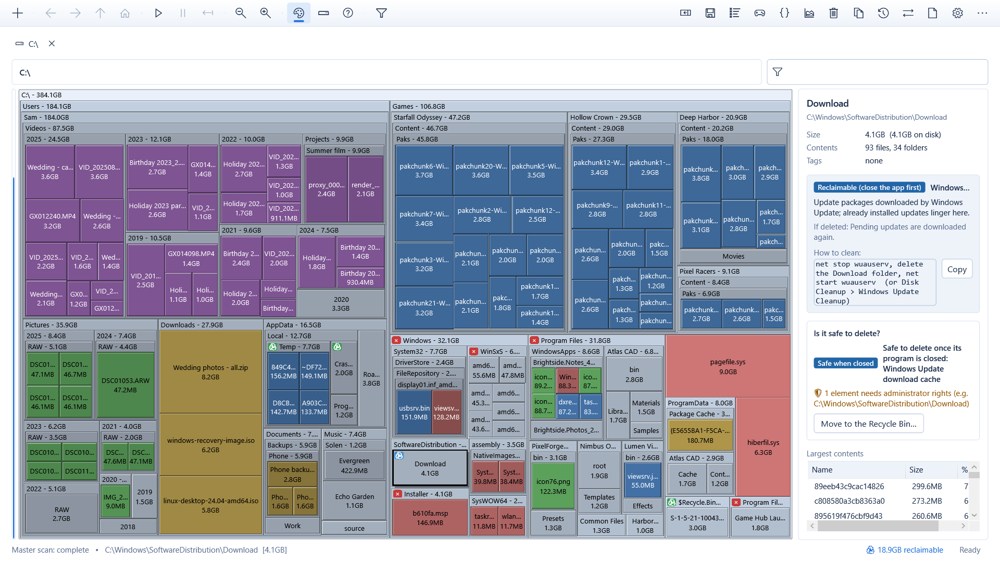
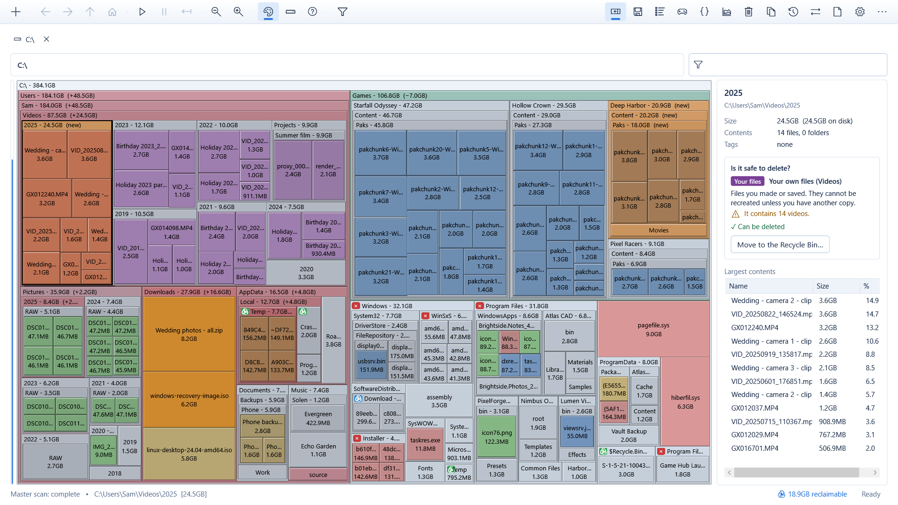
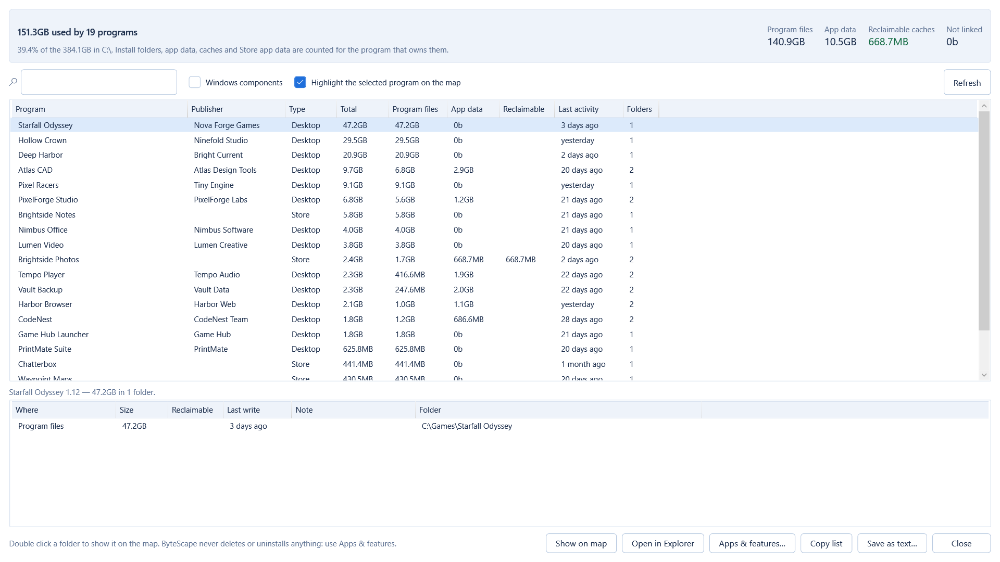
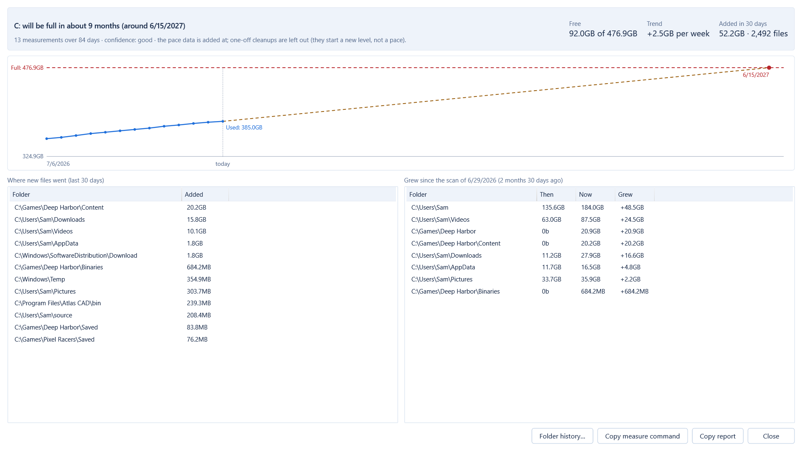

<p align="center"></p>

<h1 align="center">ByteScape</h1>

<p align="center"><b>See where your disk space went.</b><br>
A free, open-source disk space analyzer for Windows: an interactive treemap of your drives and folders that also tells
you what each big block is and whether it is safe to delete.</p>

<p align="center">
<a href="https://github.com/hayrettincevik/ByteScape/releases/latest">Download</a> ·
<a href="#features">Features</a> ·
<a href="#building-from-source">Build</a> ·
<a href="PRIVACY.md">Privacy</a> ·
<a href="LICENSE">MIT License</a>
</p>



Every block on the map is a file or a folder, drawn as big as the space it takes on the disk. The big blocks are the space
hogs: double-click to zoom in, Backspace to go back, and the details panel explains what you are looking at.

## Download

Get the latest version from the [releases page](https://github.com/hayrettincevik/ByteScape/releases/latest). Nothing to
install — put the exe in a folder of its own and run it:

| File | For |
|---|---|
| `ByteScape-<version>-x64.exe` | Any 64-bit Windows 10 or 11 PC. .NET is inside the file. |
| `ByteScape-<version>-x64-net8.exe` | A 2 MB build for PCs that have the [.NET 8 Desktop Runtime](https://dotnet.microsoft.com/download/dotnet/8.0) (or newer). |

Each release lists the SHA-256 of both files; check a download with `Get-FileHash .\ByteScape-<version>-x64.exe`.
The exes are not code-signed yet, so Windows SmartScreen may say "Windows protected your PC" for a new version: choose
**More info → Run anyway**.

## Features

- **Treemap of any drive or folder**, drawn while it scans; zoom, breadcrumb, colours by file type, a live view that
  follows changes on the disk.
- **"Is it safe to delete?"** for every file and folder. Cache Radar marks known caches and temporary folders and explains
  what deleting them does and how to clean them properly.
- **Safe cleanup**: delete to the Recycle Bin (or permanently); Windows and program folders are protected; files that need
  administrator rights or are open in a program are pointed out. Cleanup lists for large files, temporary files, old
  installers and programs you have not used for months.
- **Programs on disk**: every installed program with everything it uses — install folder, app data, caches, Store app
  data — and the folders left behind by removed programs.
- **Games** from Steam, Epic Games and GOG: when you last played each one, how much space it takes, and what uninstalled
  games left behind.
- **Developer leftovers**: `node_modules`, `bin`/`obj`, `target`, `.venv` and other rebuildable folders, per project,
  with the last time you worked on it.
- **What changed and what comes next**: compare with an earlier snapshot, disk usage history charts, and a forecast of
  when the drive will be full at the current pace.
- **Duplicate files** found by content (one copy always stays) and **folder comparison**, optionally byte by byte.
- **Fast**: parallel scanning tuned per drive type, quick rescans from the NTFS change journal (a whole system drive in
  under a second), pause and resume, an optional MFT scan when running as administrator. Hard links are counted once and
  OneDrive / Dropbox / iCloud online-only files take no space.
- **Filters**, also in plain words: `*.mp4;>100mb;<6months`, or "videos over 100 MB not opened for 6 months".
- **Reports** as CSV, JSON or a self-contained HTML page; snapshots (`.sns`) to reopen later; a command line for scripts.
- **"Open in ByteScape"** in Explorer's right-click menu.
- **Seven languages**: English, Turkish, Russian, Simplified Chinese, French, Spanish and Brazilian Portuguese — it
  follows the Windows display language.
- **Accessible**: keyboard navigation of the map, screen readers (Narrator, NVDA, JAWS) and Windows contrast themes. See
  [docs/accessibility.md](docs/accessibility.md).

<table>
<tr>
<td><br><sub>What changed since an earlier scan</sub></td>
<td><br><sub>Space used by each installed program</sub></td>
<td><br><sub>When the drive will be full</sub></td>
</tr>
</table>

<sub>The pictures show a made-up drive.</sub>

## Privacy

ByteScape collects nothing and sends nothing on its own; there is no telemetry and no account. It makes no network
connections by default: the update check of the portable version (off unless you turn it on) asks GitHub for the latest
release, and the optional local AI feature talks only to a server you run yourself. Details: [PRIVACY.md](PRIVACY.md).

## Command line

```
ByteScape.exe scan D:\ filter "*.iso;>1gb"
ByteScape.exe scan C:\ export "CSV list (spreadsheet)" "C:\reports\c-drive.csv" autoclose
ByteScape.exe scan "C:\Users" cleanupreport "cleanup.txt" autoclose
ByteScape.exe measure
```

`ByteScape.exe help` lists every command: scans, snapshots, filters, exports, comparisons, the program / game /
developer / cleanup / duplicate reports, and `measure`, which records free space for the forecast (for Task Scheduler).

## Building from source

Requirements: Windows 10 or 11 and the [.NET 8 SDK](https://dotnet.microsoft.com/download/dotnet/8.0).

```powershell
git clone https://github.com/hayrettincevik/ByteScape.git
cd ByteScape
dotnet build ByteScape.sln -c Release
dotnet test ByteScape.Tests -c Release
dotnet run --project ByteScape.Wpf -c Release
```

The portable downloads are made by `store\build-portable.ps1`, the Microsoft Store package by `store\build-msix.ps1`;
see [docs/releasing.md](docs/releasing.md).

| Project | Contents |
|---|---|
| `ByteScape.Core` | The engine: scanning, the tree model, filters, the treemap layout, analyses, deleting, exports, snapshots, settings, localization |
| `ByteScape.Wpf` | The Windows application (`ByteScape.exe`) |
| `ByteScape.Tests` | xunit tests for the engine and every window (rendered off screen) |
| `ByteScape.Diag` | A console harness for measurements, large synthetic trees and translation tools |
| `store/`, `site/` | Store package, portable build and optional web site scripts |

More: [architecture](docs/architecture.md) · [security review](docs/security-review.md) ·
[accessibility](docs/accessibility.md) · [snapshot format](docs/snapshot-format.md) · [releasing](docs/releasing.md)

## Contributing

Bug reports, translations and pull requests are welcome — see [CONTRIBUTING.md](CONTRIBUTING.md). In the program,
**⋯ → Report a problem** collects what helps to find a bug (with your user and computer names replaced) and opens a new
issue. Please report security problems privately as described in [SECURITY.md](SECURITY.md).

## License

ByteScape is free and open source under the [MIT License](LICENSE). The components it includes are listed with their
licenses in [THIRD-PARTY-NOTICES.txt](ByteScape.Core/Core/Legal/THIRD-PARTY-NOTICES.txt). The ByteScape name and logo
identify this project; please do not use them for modified versions in a way that suggests they come from it.
